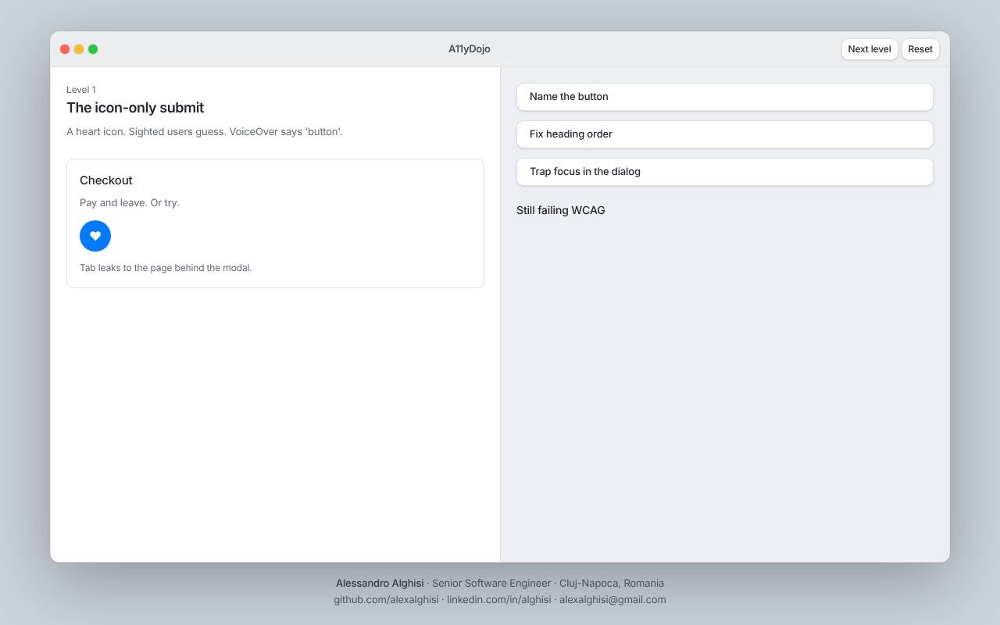

# A11yDojo

A training surface for the three WCAG failures that dominate generated
interfaces: missing accessible names, heading order that follows font size, and
keyboard focus that leaks out of a dialog.

**Download:** [latest release](https://github.com/alexalghisi/A11yDojo/releases/latest)



Levels and the pass predicate are in [`src/lib/a11y.ts`](src/lib/a11y.ts).

**React 19 · TypeScript (strict) · Vite 8 · Tailwind CSS 4 · Zustand · Vitest ·
Playwright**

---

## Author

### Alessandro Alghisi

Senior Software Engineer · Cluj-Napoca, Romania

**Twice a Google Software Engineering Intern** — Chrome (Kitchener / Waterloo)
and Logs (Mountain View).

|          |                                                                    |
| -------- | ------------------------------------------------------------------ |
| GitHub   | [github.com/alexalghisi](https://github.com/alexalghisi)           |
| LinkedIn | [linkedin.com/in/alghisi](https://www.linkedin.com/in/alghisi)     |
| Email    | [alexalghisi@gmail.com](mailto:alexalghisi@gmail.com)              |
| Location | Cluj-Napoca, Romania · open to remote / EU / US-friendly timezones |

**Hiring?** Open an issue, message me on LinkedIn, or email
[alexalghisi@gmail.com](mailto:alexalghisi@gmail.com).

---

## Getting started

Requires Node 22 or newer.

```bash
npm install
npm run dev          # http://localhost:5185
```

On level 1, **Name the button**. Status should read Level clear. Contact sits under the window.

```bash
npm run typecheck
npm run lint
npm run format:check
npm run test
npm run e2e
npm run build
```

## License

MIT · © Alessandro Alghisi
